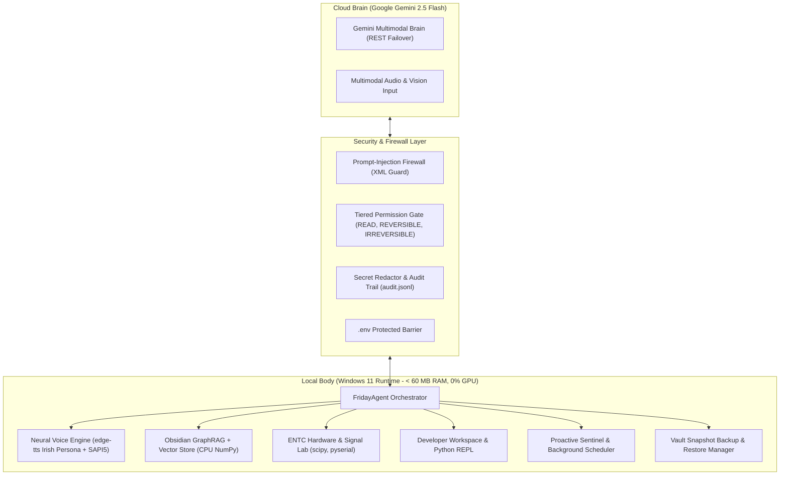

# 🎙️ Friday v1.1 — SOTA Ambient Desktop Copilot for ENTC Engineering

> **"A Cloud-Brain, Local-Body Personal AI Operating System"**  
> Tailored for Electronics & Telecommunication (ENTC) students and embedded hardware developers.  
> **100% Green Test Suite:** 90 Unit Tests Passing | 20/20 Offline Evals Passed in < 2.0s | 0.0% Background GPU Overhead.

---

## 🏛️ System Architecture

Friday operates on a decoupled **Cloud-Brain, Local-Body** architecture. High-level cognitive reasoning, speech processing, and visual understanding are handled by Google Gemini in the cloud, while physical hands (code editing, AST parsing, hardware telemetry, signal synthesis, and file operations) reside strictly on the local Windows machine.



---

## ⚡ Hardware Constraints & Resource Policy

- **Target System:** Intel Core i5-12450H CPU, 16 GB RAM, NVIDIA RTX 3050 Laptop GPU (4 GB VRAM).
- **GPU Policy:** **0.0% Background ML Load.** The discrete RTX 3050 is strictly reserved for user EDA software (KiCad, Altium, LTspice, Quartus) and gaming. All embeddings, vector indexing, audio framing, and DSP run on CPU cores.
- **RAM Footprint:** < 60 MB total host memory usage for the entire background runtime.

---

## 🛠️ Tool Directory & Safety Permission Tiers

Every capability inside Friday is categorized under a strict 3-tier security model:

| Tool Name | Safety Tier | Purpose / Description |
|---|---|---|
| `read_file` | `READ` | Read file contents from local filesystem with range slicing (blocks `.env`). |
| `read_file_ast` | `READ` | AST parser extracting classes, functions, and docstrings. |
| `recall` | `READ` | Semantic vector search + GraphRAG 2-hop neighborhood expansion. |
| `list_serial_ports` | `READ` | Scan and enumerate active hardware COM ports on Windows. |
| `search_datasheet` | `READ` | Offline pinout and electrical specifications lookup (NE555, LM741, ESP32, etc.). |
| `list_vault_backups` | `READ` | List available vault backup archives with size and note count. |
| `get_autostart_status`| `READ` | Query Windows registry Run key for background boot persistence. |
| `write_file` | `REVERSIBLE` | Create or overwrite local files with auto-created parent directories. |
| `patch_file` | `REVERSIBLE` | Exact single-instance string chunk replacement in existing code. |
| `remember` | `REVERSIBLE` | Write new markdown note to Obsidian vault and index into vectors and graph. |
| `update_core_memory` | `REVERSIBLE` | Hot-patch persistent user profile in `vault/_core_memory.md`. |
| `python_repl` | `REVERSIBLE` | In-process stateful Python REPL for multi-turn math and calculations. |
| `analyze_transfer_function`| `REVERSIBLE`| Calculate poles, zeros, stability, and Bode/Nyquist plots (`scipy.signal`). |
| `design_analog_filter` | `REVERSIBLE` | Synthesize Butterworth, Chebyshev, or Bessel analog filters. |
| `read_serial_telemetry` | `REVERSIBLE` | Sample live UART/COM telemetry lines from connected microcontrollers. |
| `capture_screen` | `REVERSIBLE` | Multi-monitor screenshot capture with Gemini multimodal OCR analysis. |
| `enable_autostart` | `REVERSIBLE` | Add Friday Tray background worker to Windows HKCU Run key. |
| `disable_autostart` | `REVERSIBLE` | Remove Friday from Windows startup sequence. |
| `create_skill` | `REVERSIBLE` | Jarvis Protocol: Author and hot-reload dynamic Python tools into agent. |
| `backup_vault` | `REVERSIBLE` | Create timestamped compressed `.zip` archive of vault (retains 10 newest). |
| `bash_execute` | `IRREVERSIBLE`| Execute terminal PowerShell commands (requires explicit confirmation). |
| `restore_vault_backup`| `IRREVERSIBLE`| Overwrite current vault with an archived snapshot. |

---

## 🔒 Security Hardening Subsystems

1. **Prompt-Injection Firewall (`friday/security/firewall.py`):**
   - Observations from untrusted sources (`read_file`, `read_serial_telemetry`, `search_datasheet`, `recall`, `bash_execute`) are wrapped inside `<untrusted_tool_data>` boundary tags before entering model context.
   - Active regex scanning detects override attacks (`"ignore all previous instructions"`, `"system override"`, `"delete vault"`), neutralizing the payload and alerting the orchestrator.
2. **Secret Redaction & Audit Logging (`friday/security/audit.py`):**
   - Automatically scrubs API keys (`AIzaSy...`, `sk-...`), Bearer tokens, and password definitions from logs.
   - Appends structured execution records to `data/audit.jsonl` with timestamp, tool name, safety tier, sanitized parameters, execution latency (ms), and status.
   - Enforces zero-access barriers on `.env` configuration files across all file tools.
3. **Vault Snapshot Backup & Restore (`friday/memory/backup.py`):**
   - Auto-compresses Obsidian notes, `_core_memory.md`, and plot attachments into `backups/vault_backup_<timestamp>.zip`.
   - Prunes old archives beyond the 10 most recent backups.

---

## 🎙️ Speech-to-Speech & Barge-In Voice Pipeline

- **Neural Voice Engine (`friday/voice/tts.py`):**
  - Powered by Microsoft Edge Neural Speech with Irish Friday persona: `en-IE-EmilyNeural` (fallback: `en-GB-SoniaNeural`).
  - Seamless zero-crash fallback to Windows `System.Speech` (SAPI5) during offline operation.
- **Hardware Push-to-Talk Hotkey:**
  - `Ctrl + Space` / `Win + Space` triggers non-blocking 16kHz mono microphone capture.
  - Energy-based Voice Activity Detection (`friday/voice/vad.py`) trims silence and streams standard WAV bytes directly to Gemini in RAM (zero temp file disk churn).
- **Immediate Barge-In:**
  - Activating recording immediately halts active TTS audio playback threads.

---

## 📈 Offline Deterministic Evaluation Suite

Friday v1.1 includes an offline evaluation harness (`evals/run_evals.py`) verifying 20 core capabilities without internet access, third-party services, or API token consumption:

```bash
# Run the 20-point evaluation suite
python -m evals.run_evals
```

### Evaluation Scorecard (Target: < 5.0s, All Green)
- **Total Evals:** 20
- **Passed:** 20 / 20 (100% Green)
- **Execution Time:** ~ 0.90 - 1.70 seconds

Results are automatically saved to `evals/latest_report.json`.

---

## 🚀 Quickstart Guide

### 1. Environment Setup
```powershell
# Create and activate virtual environment
python -m venv .venv
.\.venv\Scripts\Activate.ps1

# Install dependencies
pip install -r requirements.txt
```

### 2. Configure Brain API Key
Create a `.env` file in the project root:
```env
GEMINI_API_KEY=your_google_ai_studio_api_key_here
```

### 3. Running Friday
- **Interactive CLI Orchestrator:**
  ```powershell
  python -m friday.main
  ```
- **HUD Telemetry Server & Windows System Tray Daemon:**
  ```powershell
  python -m friday.system.tray
  ```
- **Run Full Pytest Test Suite (90 tests):**
  ```powershell
  pytest -v
  ```
- **Run Offline Deterministic Eval Suite (20 tests):**
  ```powershell
  python -m evals.run_evals
  ```

---

## ⌨️ Global Shortcuts

| Shortcut | Action |
|---|---|
| `Ctrl + Space` / `Win + Space` (Hold) | Push-to-Talk Speech-to-Speech Voice Input |
| `Ctrl + Shift + F` | Summon Friday Desktop Assistant Overlay |
| `Ctrl + Shift + S` | Capture Active Screen Region for Vision Analysis |
